# 🚀 Awesome Semantic Layer &amp; Headless BI

### *A Curated Directory of Governed Metric Definitions, Headless Serving APIs, and AI-Ready Semantics*

  
  
  
  
  
  
  

---

**Last updated: March 2026** • Maintained by data engineers, analytics engineers, and AI practitioners.

## 📖 Introduction &amp; SEO Summary

A **Semantic Layer** (also referred to as a **Metrics Store**, **Universal Semantic Layer**, or **Headless BI engine**) provides a unified, governed abstraction layer between underlying data warehouses or lakehouses (Snowflake, Databricks, BigQuery, ClickHouse, DuckDB) and downstream consumers (BI dashboards, embedded customer analytics, microservices, and Generative AI agents). 

By defining business calculations (such as `Gross Revenue`, `Net Retention`, `Active Subscribers`, and `CAC`) **once in code or declarative configuration**, teams avoid contradictory metric logic across departments, prevent calculation drift, and ensure that Large Language Models (LLMs) and Text-to-SQL agents query authoritative, hallucination-free business metrics.

### 🎯 Key Architectural Pillars
- **📐 Governed Metrics-as-Code**: Dimensions, metrics, joins, and grain definitions declared in version-controlled files (YAML, LookML, Malloy, Python).
- **⚡ Headless Serving**: Metric consumption decoupled from visualization, exposing high-performance SQL, REST, GraphQL, and Arrow Flight APIs.
- **🏎️ Intelligent Pre-Aggregation &amp; Caching**: Acceleration engines and OLAP cubes that serve sub-second queries to thousands of concurrent users.
- **🤖 AI &amp; Agent Context Ready**: Semantic catalog and MCP (Model Context Protocol) integration so AI assistants understand enterprise business logic without schema guesswork.

---

## 📑 Table of Contents

- [🌐 Sector Overview &amp; Market Dynamics](#-sector-overview--market-dynamics)
- [🏢 SaaS &amp; Enterprise Platforms](#-saas--enterprise-platforms)
- [💻 Open-Source GitHub Projects](#-open-source-github-projects)
- [⚖️ Architectural Comparison Matrix](#️-architectural-comparison-matrix)
- [🤝 How to Contribute](#-how-to-contribute)
- [📈 Star History](#-star-history)
- [💖 Support](#-support)
- [📜 Disclaimer](#-disclaimer)

---

## 🌐 Sector Overview &amp; Market Dynamics

The global Business Intelligence and Semantic Layer market is currently estimated at **$32.5 Billion in 2024–2026** and is projected to expand beyond **$55+ Billion by 2030** at a compound annual growth rate (CAGR) of **~12–14%**, substantially accelerated by enterprise adoption of GenAI, automated analytical agents, and multi-cloud data architectures.

The sector is **moderately fragmented and undergoing dynamic structural realignment**:
1. **Cloud Warehouse Dominance**: Incumbents such as Snowflake (Semantic Views / Cortex Analyst), Databricks (Unity Catalog Metric Views), and Google Cloud (Looker / LookML) are expanding built-in metric governance to build sticky analytical ecosystems within their proprietary storage and compute layers.
2. **Headless &amp; Warehouse-Agnostic Demand**: Concurrently, modern enterprise stacks demand independent, open-standard semantic platforms (such as Cube, dbt MetricFlow, and AtScale) that bridge heterogeneous data sources, serve embedded customer-facing apps, avoid single-vendor lock-in, and provide unified semantic context across any BI dashboard or autonomous AI agent.

---

## 🏢 SaaS &amp; Enterprise Platforms

The table below lists the top commercial Semantic Layer and Headless BI platforms, **sorted in descending order by parent company scale (valuation / market capitalization / revenue)**.

| 🏢 Platform / Vendor | 💰 Company Scale (Valuation / Revenue) | 🏷️ Starting Pricing Tier | 🎁 Free Tier / Trial Limits | 🎯 Core Semantic Architecture &amp; Use Case |
| :--- | :--- | :--- | :--- | :--- |
| **[Looker (Google Cloud)](https://cloud.google.com/looker)** | **Market Cap ~$2.1T+** (Alphabet Inc.) / **$36B+** Google Cloud ARR | **$3,000/month** ($36,000/year platform fee for Standard Edition) + user seat licenses ($30–$125/user/month) | **30-day free trial** on Google Cloud with **$300 in credits** for new accounts (no permanent free tier) | Centralized LookML semantic modeling, Persistent Derived Tables (PDTs), Open SQL JDBC interface for BigQuery, and Gemini in Looker AI assistant. |
| **[Snowflake Semantic Views](https://www.snowflake.com/)** | **Market Cap ~$50B+** (NYSE: SNOW) / **~$2.8B+** Annual Revenue | **$2.00/credit** on Standard Edition (~$2.00/hour for an X-Small virtual warehouse); Premier at $2.25/credit; Enterprise at $3.00/credit | **30-day free trial** with **$400 worth of free usage credits** (no permanent free tier) | Warehouse-native semantic definitions in Snowflake control plane; powers Cortex Analyst and natural language search without data movement. |
| **[Databricks Metric Views](https://www.databricks.com/)** | **Valuation ~$43B+** / **~$2.4B+** ARR | **$0.07–$0.15/DBU** on Standard/Enterprise compute; Serverless SQL starts at **~$0.22/DBU** | **14-day full free trial** on major clouds; **Databricks Community Edition** free forever (1 micro-cluster, 15GB RAM, non-production) | Governed YAML metric definitions integrated into Unity Catalog; provides unified semantic context for Databricks Genie and Lakehouse dashboards. |
| **[dbt Semantic Layer](https://www.getdbt.com/product/semantic-layer)** | **Valuation $4.2B** (dbt Labs) / **~$100M+** ARR | **$100/developer seat/month** (Starter tier includes 5,000 queried metrics/month); Team/Enterprise custom | **14-day full free trial** of dbt Cloud Starter; **Developer Plan free forever** (1 developer seat, 1 project; Semantic Layer requires Starter or MetricFlow OSS) | Metric definitions version-controlled right inside transformation models; dispatches SQL via MetricFlow with GraphQL &amp; JDBC APIs for Tableau, Hex, and Power BI. |
| **[Transform](https://transform.co/)** *(Acquired by dbt Labs)* | **Part of dbt Labs ($4.2B Valuation)**; acquired for **~$50M+** in 2023 | **$100/seat/month** via dbt Cloud Starter (standalone product retired) | Standalone free trial retired; accessible through **dbt Cloud 14-day free trial** | The pioneer metrics store platform that originated MetricFlow; now unified within the dbt Semantic Layer ecosystem. |
| **[Hex](https://hex.tech/)** | **Valuation ~$500M** / **$100M+** raised (Sequoia, a16z, Snowflake, Databricks) | **$36/editor/month** (Professional tier, annual billing); Team tier at $75/editor/month; viewers are free | **Community Plan free forever** (1 editor, 5 projects, unlimited viewers, 100 AI actions/month, 5 compute hrs/month) + **14-day Team trial** | Collaborative analytics workspace integrating notebooks, SQL, and direct metric store consumption from Cube and dbt Semantic Layer. |
| **[Cube Cloud](https://cube.dev/)** | **Valuation ~$150M+** / **$40M+** total funding | **$40/developer/month** (Starter tier); Premium tier at $80/developer/month; dedicated infra at $0.60–$1.20/hour | **Free Plan forever** (up to 5 workbooks/models, 1 concurrent query, community support) + **30-day Cloud trial** with **$50 infrastructure credits** | Purpose-built headless BI serving layer with high-performance pre-aggregations, caching, REST, GraphQL, SQL, and DAX APIs for embedded apps. |
| **[AtScale](https://www.atscale.com/)** | **Valuation ~$150M+** / **$130M+** total funding / **~$35M** ARR | **~$2,500/month** (~$30,000/year contract) based on Deployed Semantic Objects (DSOs) | **14-day guided sandbox free trial** with pre-configured TPC-DS datasets; 30-day enterprise evaluation POC | Universal semantic layer with autonomous virtual OLAP acceleration, native DAX/Power BI tabular integration, SML modeling language, and Ava AI clarification agent. |
| **[Omni](https://omni.co/)** | **Valuation ~$100M+** / **$27M+** total funding (Redpoint, First Round) | **$1,000/month** (Core tier for small teams; includes 5 creators/explorers and unlimited free viewers) | **14-day customized evaluation trial** with live database connectivity and dedicated onboarding | Modern BI and modeling platform combining code-based metric governance with fast, flexible point-and-click exploration. |
| **[GoodData](https://www.gooddata.com/)** | **Valuation ~$100M+** / **$100M+** total funding / **~$45M** ARR | **$1,500/month** (Professional tier; includes 3 workspaces and standard data volume; custom quote beyond) | **30-day full-featured Cloud free trial** (unlimited users, 3 workspaces, 100MB cache) + **GoodData Community Docker** free forever for eval | Composable analytics-as-code platform with declarative metrics engine, headless APIs, and multi-tenant embedded analytics for SaaS products. |

---

## 💻 Open-Source GitHub Projects

The following open-source semantic layers, metrics engines, and code-first analytical platforms are **sorted in descending order by GitHub stargazers count**.

### 1. [Apache Superset](https://github.com/apache/superset) 
- **License**: Apache 2.0 • **Language**: Python / TypeScript
- **Overview**: The enterprise-grade open-source modern data exploration and dashboard platform. While primarily a visualization tool, Superset features built-in dataset semantic definitions, calculated metrics, and native connectivity to external semantic layers like Cube and MetricFlow.
- **Best For**: Organizations deploying self-hosted, scalable BI connected to governed warehouse semantic layers.

### 2. [Metabase](https://github.com/metabase/metabase) 
- **License**: AGPLv3 / Commercial • **Language**: Clojure / JavaScript
- **Overview**: The most popular open-source business intelligence and embedded analytics tool. Metabase allows data teams to define reusable models, metadata, and custom metrics with visual and SQL query builders.
- **Best For**: Fast company-wide self-serve exploration and simple embedded analytics.

### 3. [DuckDB](https://github.com/duckdb/duckdb) 
- **License**: MIT • **Language**: C++
- **Overview**: An ultra-fast in-process analytical SQL database engine. DuckDB has become the bedrock execution engine for modern local and embedded semantic layers, enabling instant query compilation over Parquet, Arrow, and remote object stores without external database infrastructure.
- **Best For**: Embedded semantic acceleration, serverless metric serving, and local development.

### 4. [Cube Core](https://github.com/cube-js/cube) 
- **License**: Apache 2.0 • **Language**: Rust / JavaScript
- **Overview**: The leading open-source universal semantic layer and headless BI engine. Cube defines data models in code (YAML or JavaScript/Python), manages pre-aggregations, caches results, and serves governed metrics via REST, GraphQL, SQL API (Postgres protocol), and DAX for Power BI.
- **Best For**: Engineering teams building embedded analytics, customer-facing portals, and decoupled headless metric APIs.

### 5. [Wren AI](https://github.com/Canner/WrenAI) 
- **License**: Apache 2.0 • **Language**: Java / TypeScript / Python
- **Overview**: An open-source, GenAI-native semantic context layer designed specifically for LLM text-to-SQL agents. Wren AI bridges ambiguous natural-language business questions with accurate SQL generation using an explicit semantic context engine across 20+ warehouse dialects.
- **Best For**: Teams deploying AI analytics agents and zero-hallucination conversational interfaces on their warehouses.

### 6. [dbt-core](https://github.com/dbt-labs/dbt-core) 
- **License**: Apache 2.0 • **Language**: Python
- **Overview**: The industry standard for data transformation in modern warehouses. Powers metrics definitions via dbt semantic specifications and integration with downstream engines like MetricFlow.
- **Best For**: Data transformation, lineage governance, and upstream semantic definitions.

### 7. [Evidence](https://github.com/evidence-dev/evidence) 
- **License**: MIT • **Language**: Svelte / TypeScript
- **Overview**: Business intelligence as code. Evidence compiles Markdown and SQL into lightning-fast, interactive data web applications and reports, with automatic version control and CI/CD pipelines.
- **Best For**: Analytics engineers who want code-driven, fast, and version-controlled BI reports.

### 8. [Lightdash](https://github.com/lightdash/lightdash) 
- **License**: MIT • **Language**: TypeScript / Node.js
- **Overview**: The open-source BI platform natively designed for dbt. Lightdash translates dbt model YAML configurations into self-serve BI catalogs, exploratory dashboards, and AI-assisted documentation.
- **Best For**: Teams using dbt who want an immediate self-serve BI layer without maintaining separate visualization models.

### 9. [Rill](https://github.com/rilldata/rill) 
- **License**: Apache 2.0 • **Language**: Go / TypeScript
- **Overview**: Lightning-fast operational BI and metrics layer powered by an embedded DuckDB engine. Rill combines declarative metric definitions in YAML with instant, sub-second interactive dashboards.
- **Best For**: Operational metrics, event stream analysis, and rapid local dashboard iteration.

### 10. [Malloy](https://github.com/malloydata/malloy) 
- **License**: MIT • **Language**: TypeScript
- **Overview**: A modern open-source language for describing data relationships, hierarchies, and metric calculations, created by the original founders of Looker. Malloy compiles concise semantic queries into optimized SQL.
- **Best For**: Next-generation semantic modeling, nested queries, and programmatic SQL compilation.

### 11. [MetricFlow](https://github.com/dbt-labs/metricflow) 
- **License**: Apache 2.0 • **Language**: Python
- **Overview**: The open-source metrics engine powering the dbt Semantic Layer. MetricFlow parses declarative YAML specifications to construct semantic graphs and compile complex, multi-hop aggregate SQL queries dynamically.
- **Best For**: Teams building custom metric serving layers using dbt specifications.

---

### 📦 Specialized Open-Source Tools &amp; Libraries

- **[semlayer](https://pypi.org/project/semlayer/)** *(PyPI package)*: An automated, self-inferring semantic layer engine. It scans warehouse schemas to discover undeclared foreign keys, decode categorical columns, extract business logic from aggregate tables, and expose an MCP (Model Context Protocol) context layer for AI agents.
- **[OrionBelt Semantic Layer](https://github.com/ralfbecher/awesome-business-intelligence)**: Open-source semantic sidecar compiling YAML semantic models to optimized SQL across 8 engines (BigQuery, ClickHouse, Databricks, Dremio, DuckDB, MySQL, PostgreSQL, Snowflake) with REST and Arrow Flight interfaces.
- **[SLayer (semanticslayer)](https://github.com/motley-ai)**: Minimalist semantic layer by Motley supporting YAML metric definitions, formula support (time shifts, cumulative sums), and lightweight CLI/Python clients.

---

## ⚖️ Architectural Comparison Matrix

| Feature Dimension | Cube Core / Cloud | dbt Semantic Layer | AtScale | Looker (LookML) | Wren AI |
| :--- | :--- | :--- | :--- | :--- | :--- |
| **Primary Focus** | Headless serving &amp; API access | Transformation-native metrics | Virtual OLAP &amp; Enterprise BI | Enterprise End-to-End BI | GenAI Text-to-SQL context |
| **Modeling Language** | YAML / JavaScript / Python | YAML (MetricFlow Spec) | SML / Visual Studio / YAML | LookML | Visual UI / Context Schema |
| **Serving APIs** | REST, GraphQL, SQL (PG wire), DAX | GraphQL, JDBC | DAX, MDX, PGWire, REST | Open SQL (JDBC), REST | REST, Text-to-SQL Agent API |
| **Caching / Acceleration** | Pre-aggregations (Store/Worker) | Warehouse compute dispatch | Autonomous Virtual OLAP | Persistent Derived Tables (PDTs) | Vector &amp; Relationship Graph |
| **AI / LLM Integration** | Semantic Context API &amp; LangChain | AI Context in dbt Cloud | Ava &amp; Databricks Genie / Cortex | Gemini in Looker | Native GenBI multi-agent engine |
| **Self-Hosting Model** | ✅ 100% Free Apache 2.0 Core | ⚠️ Engine OSS (Cloud proprietary) | ❌ Commercial enterprise | ❌ Cloud SaaS only | ✅ 100% Free Apache 2.0 |

---

## 🤝 How to Contribute

Contributions are welcome and highly appreciated! To contribute to this list:

1. **Fork the repository** on GitHub.
2. **Add or update entries** in [README.md](file:///C:/Users/hp/Documents/Projects/Awesome-Semantic-Layer-Headless-BI/README.md).
3. Ensure entries adhere to our criteria:
   - Factual, objective descriptions with direct links to official sites or repositories.
   - For SaaS products: include specific starting pricing tiers, explicit free tier/trial limits, and company scale.
   - For open-source repos: include correct GitHub stars badge linking to the stargazers page, license, and repository URL.
4. **Submit a Pull Request** with a descriptive summary of your additions.

---

## 📈 Star History

---

## 💖 Support

If you find this curated semantic layer directory valuable:
- ⭐ **Star this repository** to support discoverability and bookmark it for updates!
- 🍴 **Fork and share** with colleagues, data engineering communities, and analytics engineering teams.
- ☕ **Sponsor &amp; Buy a Coffee**: Support ongoing maintenance and curated open-source research via the [GitHub Sponsor Dashboard](https://github.com/sponsors/ishandutta2007).

---

## 📜 Disclaimer

- This is an independent, community-curated directory — inclusion does not imply commercial endorsement.
- Semantic layer architectures differ substantially in latency profiles, infrastructure requirements, and lock-in implications. Evaluators should benchmark query compilation times, caching granularity, and API compatibility against their target warehouse stack.
- Pricing, free trial limits, and star counts reflect verified data as of early 2026 and may change over time.
